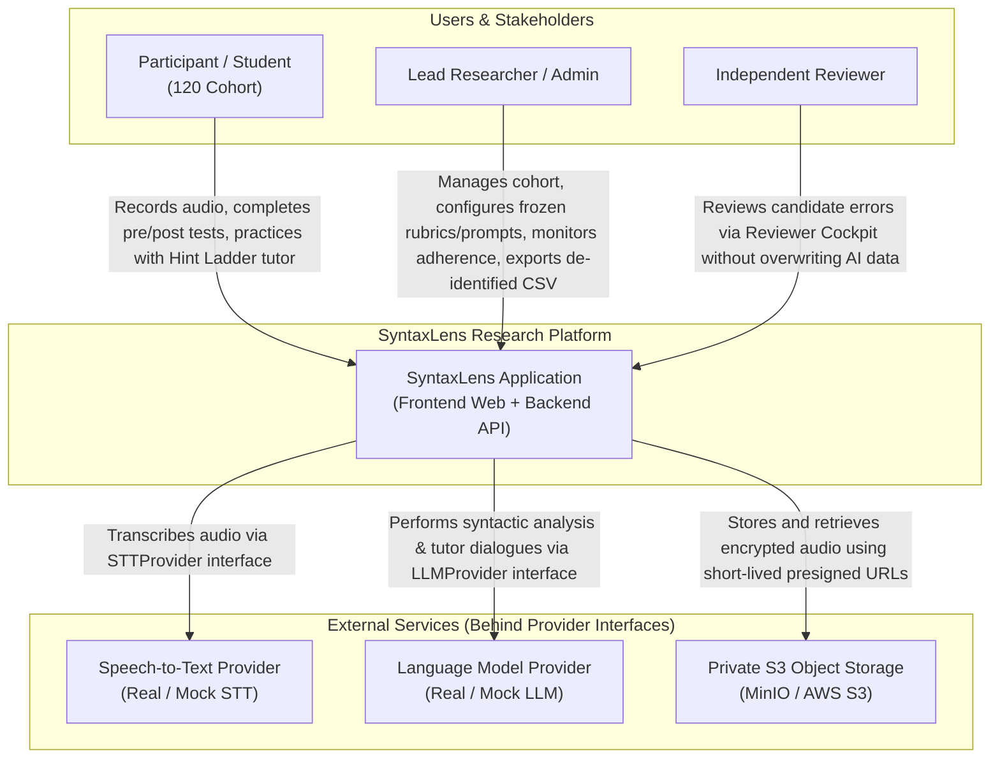
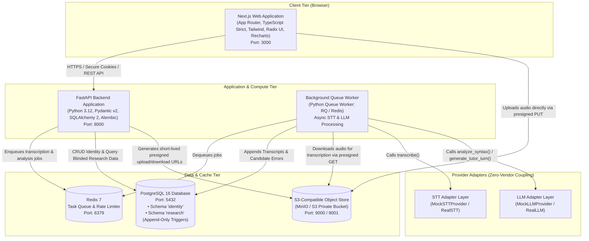
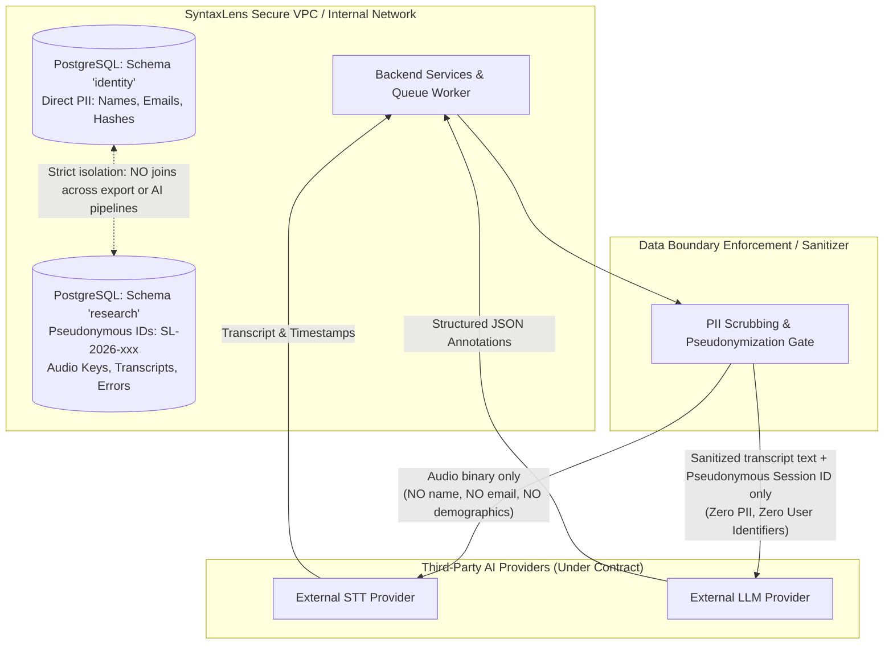

# SyntaxLens System Architecture Specification

## 1. Executive Architectural Overview

SyntaxLens is a research-grade, production-grade web application engineered for conducting empirical research on syntactic deviations in spoken English by Indian speakers. The architecture strictly adheres to the PhD research protocol and Software Requirements Specification (`docs/SRS.md`).

### Non-Negotiable Architectural Principles
1. **Separation of Assessment and Tutoring (SRS §7, §8)**:
   The official Assessment Engine (scoring pre-test and post-test spontaneous speech) is completely isolated from the Conversational Tutor. The tutor can **never** write to, mutate, or alter official assessment records or error counts.
2. **Server-Side Blinding (SRS §6 FR-11, §16.6)**:
   During active pre-test and post-test phases, the server refuses to return error feedback, candidate annotations, or scores to participant clients, regardless of any frontend presentation state.
3. **Database-Enforced Research Immutability (SRS §7, §12)**:
   Transcripts, original AI candidate annotations, consents, and audit logs are strictly append-only. Triggers enforce this rule at the database level. Reviewer decisions exist as separate rows referencing AI candidates.
4. **Decoupled Provider Interfaces (SRS §11)**:
   All Speech-to-Text (STT) and Large Language Model (LLM) operations sit behind provider interfaces (`STTProvider`, `LLMProvider`) with deterministic mock implementations to guarantee zero-API-key execution and test reproducibility.
5. **Privacy and PII Isolation (SRS §5, §13)**:
   Identity data (credentials, direct identifiers) lives in a separate PostgreSQL schema (`identity`) from research records (`research`). AI providers receive only pseudonymous IDs and raw speech/transcript text.

---

## 2. System Context & Container Diagrams (C4 Level 1 & Level 2)

### 2.1. System Context Diagram (Level 1)



---

### 2.2. Container Diagram (Level 2)



---

## 3. Core Component Breakdown

| Component | Technology | Primary Responsibilities |
|---|---|---|
| **Web App** | Next.js (App Router), TypeScript, Tailwind CSS, Radix UI | Participant onboarding, audio recording (MediaRecorder API), interactive Evidence Lens, Hint Ladder tutor interface, Reviewer Cockpit, Research Dashboards. Zero direct business-rule re-implementation. |
| **API Server** | FastAPI (Python 3.12), Pydantic v2, SQLAlchemy 2 | Authentication (Argon2id, httpOnly cookies), RBAC, server-side blinding enforcement, presigned URL generation, participant management, configuration freezing. |
| **Queue Worker** | Python Worker + Redis | Asynchronous, non-blocking audio transcription, candidate syntactic deviation analysis, pilot gold-set batch scoring. |
| **Database** | PostgreSQL 16 | Relational persistence with schema-level isolation (`identity` vs `research`) and database triggers prohibiting updates/deletions on research tables. |
| **Object Storage** | MinIO (local dev) / S3 (production) | Private bucket for encrypted participant audio. Never exposed publicly; accessed strictly via 15-minute presigned URLs. |
| **Cache & Queue** | Redis 7 | Job queuing for long-running speech/AI tasks, distributed rate-limiting, and idempotency key caching. |
| **Pure Metrics Engine** | Python (`app/research/metrics.py`) | Single source of mathematical truth for word counts, error rates per 100 words, reductions, inter-reviewer agreement ($\kappa$), and pilot metrics (WER, precision, recall). |
| **STT Adapter** | `STTProvider` Interface | Decoupled speech-to-text. Real adapter (e.g. Whisper/Deepgram) and deterministic Mock adapter for zero-API-key testing. |
| **LLM Adapter** | `LLMProvider` Interface | Decoupled syntax analysis and dialog. Real adapter and deterministic Mock adapter. |

---

## 4. The Three Distinct AI Roles (SRS §8)

SRS Section 8 explicitly mandates three isolated prompt behaviors to protect research validity. Under no circumstances may tutor progress influence official assessment scores.

```mermaid
flowchart LR
    subgraph Pre_Test_Assessor["Role A: Pre-Test Assessor (SRS §8.A)"]
        direction TB
        A1["Neutral, objective evaluator"]
        A2["NO hints, NO feedback, NO coaching"]
        A3["Faithful transcription + error tagging"]
        A4["Output: Immutable baseline records"]
    end

    subgraph Conversational_Tutor["Role B: AI Tutor (SRS §8.B)"]
        direction TB
        B1["Supportive conversational guide"]
        B2["Reads verified pre-test priorities"]
        B3["Executes 4-step Hint Ladder (L0-L3)"]
        B4["Logs practice events & transfer checks"]
        B5["CRITICAL: CANNOT modify assessment scores"]
    end

    subgraph Post_Test_Assessor["Role C: Post-Test Assessor (SRS §8.C)"]
        direction TB
        C1["Independent, blind evaluator"]
        C2["Identical rubric & task conditions"]
        C3["NO coaching, NO tutor context"]
        C4["Output: Immutable post-test records"]
    end

    Pre_Test_Assessor -->|"Verified baseline priorities only"| Conversational_Tutor
    Conversational_Tutor -.->|"Strict Wall: NO score writes"| Post_Test_Assessor
```



### Detailed Role Separation Matrix

| Dimension | Role A: Pre-Test Assessor | Role B: AI Conversational Tutor | Role C: Post-Test Assessor |
|---|---|---|---|
| **Tone & Stance** | Neutral, clinical, non-judgmental. | Encouraging, pedagogical, conversational. | Neutral, clinical, identical to Pre-Test. |
| **Learner Feedback** | **Zero**. Blinding enforced server-side. | Progressive scaffolding (Hint Ladder L0–L3). | **Zero**. Blinding enforced server-side. |
| **Inputs** | Raw audio & assigned JAM prompt. | Verified baseline priorities & recent tutor turns. | Raw audio & alternate JAM prompt. |
| **Outputs** | Faithful transcript & candidate errors. | Conversational replies, hints, transfer prompts. | Faithful transcript & candidate errors. |
| **Score Authority** | Official baseline score. | **Zero score authority** (logs practice events only). | Official post-intervention score. |
| **Rubric Version** | Frozen study rubric (e.g. `v1.0-jam-phd`). | Frozen tutor prompt (e.g. `v1.0-tutor-ladder`). | Same frozen study rubric (`v1.0-jam-phd`). |

---

## 5. End-to-End Sequence Diagrams

### 5.1. Pre-Test Assessment Sequence (Capture $\rightarrow$ Upload $\rightarrow$ Transcribe $\rightarrow$ Analyse $\rightarrow$ Review)

```mermaid
sequenceDiagram
    autonumber
    actor Participant as Student / Participant
    participant Web as Web App (Frontend)
    participant API as Backend API
    participant S3 as Object Storage (MinIO/S3)
    participant Redis as Redis Queue
    participant Worker as Background Worker
    participant STT as STT Provider
    participant LLM as LLM Provider
    participant DB as PostgreSQL DB
    actor Reviewer as Independent Reviewer

    Note over Participant, API: Active Pre-Test Task (Server Blinding Active)
    Participant->>Web: Clicks 'Start Pre-Test'
    Web->>API: GET /api/v1/assessment/task (Pre-Test)
    API->>DB: Fetch active task topic from frozen bank
    API-->>Web: Return topic, instructions, duration (60s), prep time (30s)
    
    Participant->>Web: Records speech & clicks 'Submit Recording'
    Web->>API: POST /api/v1/assessment/upload-url (task_id, checksum)
    API-->>Web: Presigned S3 PUT URL (valid 15m) + assessment_id
    Web->>S3: PUT audio binary direct to private bucket
    Web->>API: POST /api/v1/assessment/submit (assessment_id, audio_key)
    
    API->>DB: Insert assessment (status: processing, append-only)
    API->>Redis: Enqueue job (assessment_id)
    API-->>Web: 202 Accepted (submission confirmed, NO scores/feedback)

    Worker->>Redis: Dequeue job
    Worker->>S3: Fetch audio binary
    Worker->>STT: transcribe(audio_bytes)
    STT-->>Worker: STTResult (transcript, word timestamps)
    
    Worker->>LLM: analyze_syntax(transcript, rubric_version)
    LLM-->>Worker: AnalysisResult (candidate errors, spans, categories)
    
    Worker->>DB: INSERT into assessments (transcript, word_count)
    Worker->>DB: INSERT into error_annotations (candidates, confidence, status: 'candidate')
    Worker->>DB: INSERT into audit_logs (ASSESSMENT_PROCESSED)
    
    Note over Reviewer, DB: Reviewer Cockpit Workflow (SRS FR-10)
    Reviewer->>API: GET /api/v1/reviews/queue
    API->>DB: Fetch unreviewed candidate annotations
    API-->>Reviewer: Return transcript + candidate spans + audio signed URL
    Reviewer->>API: POST /api/v1/reviews/decide (annotation_id, decision: ACCEPT/REJECT/EDIT)
    API->>DB: INSERT into reviewer_decisions (separate row, NEVER overwrites error_annotations)
```

---

### 5.2. Personalised Tutor Session & Hint Ladder Sequence (SRS FR-11, FR-12)

```mermaid
sequenceDiagram
    autonumber
    actor Participant as Student / Participant
    participant Web as Web App (Frontend)
    participant API as Backend API
    participant LLM as LLM Provider
    participant Metrics as Pure Metrics Engine
    participant DB as PostgreSQL DB

    Note over Participant, DB: Tutor Initialization (Post Pre-Test Verification)
    Participant->>Web: Clicks 'Start Practice Session'
    Web->>API: POST /api/v1/practice/session/start
    API->>DB: Query verified pre-test error priorities (e.g. SVA, TNS)
    API->>DB: INSERT into practice_sessions (status: 'active')
    API-->>Web: Return session_id & target category (SVA)

    Participant->>Web: Learner speaks/types: "He go to college every day."
    Web->>API: POST /api/v1/practice/turn (session_id, utterance, ladder_level: 0)
    
    API->>LLM: generate_tutor_turn(target='SVA', utterance='He go to...', ladder_level=0)
    LLM-->>API: TutorResponse (L0: Quote: "He go to college...")
    API->>DB: INSERT into practice_events (feedback_level=0, attempt_type='independent', is_correct=false)
    API-->>Web: Render L0 quote card

    Participant->>Web: Learner requests hint / attempts again
    Web->>API: POST /api/v1/practice/turn (ladder_level: 1)
    API->>LLM: generate_tutor_turn(ladder_level=1)
    LLM-->>API: TutorResponse (L1: Question: "What ending is added for he/she/it in simple present?")
    API->>DB: INSERT into practice_events (feedback_level=1, attempt_type='hint_assisted', is_correct=false)
    API-->>Web: Render L1 hint card

    Note over Participant, Web: Ladder continues: L2 (Rule cue) -> L3 (Reveal answer + Transfer check)
    Participant->>Web: Learner succeeds on transfer: "My friend works at hospital."
    Web->>API: POST /api/v1/practice/turn (transfer_phrase, is_correct=true)
    API->>DB: UPDATE practice_events (transfer_correct=true)
    API-->>Web: Celebrate transfer & suggest next topic
    Note over API, DB: Formal assessment score is NEVER altered by practice events
```

---

### 5.3. Post-Test & Comparative Research Metrics Sequence (SRS FR-15, FR-16, §7)

```mermaid
sequenceDiagram
    autonumber
    actor Participant as Student / Participant
    participant Web as Web App (Frontend)
    participant API as Backend API
    participant Worker as Background Worker
    participant Metrics as Pure Metrics Engine
    participant DB as PostgreSQL DB
    actor Researcher as Lead Researcher

    Note over Participant, DB: Post-Test Task Execution
    Participant->>Web: Submits Post-Test Audio (Topic B: "College Routine")
    Web->>API: Submit recording under identical rubric version
    API->>Worker: Enqueue Post-Test Pipeline
    Worker->>DB: Append Post-Test transcript & candidate annotations
    
    Note over Researcher, DB: Research Dashboard & Comparative Analytics
    Researcher->>API: GET /api/v1/research/participants/{id}/comparison
    API->>DB: Fetch Pre-Test Assessment + Annotations (Verified/Accepted)
    API->>DB: Fetch Post-Test Assessment + Annotations (Verified/Accepted)
    
    API->>Metrics: compare_assessments(pre_metrics, post_metrics)
    Note over Metrics: Pure calculation: rate/100 words, abs reduction, rel reduction (0-baseline protection), disclaimer
    Metrics-->>API: ComparativeMetricsResult
    API-->>Researcher: Return JSON with Syntax Fingerprint data, low-count flags & Reproducibility metadata
```

---

## 6. Trust Boundaries & Data Flow to External Providers

Security and privacy boundaries must follow OWASP ASVS L2 and research ethics protocols (SRS §13).



### Data Cross-Border Policy Matrix

| Data Item | Stored Internally? | Transmitted to STT? | Transmitted to LLM? | Included in Research CSV Export? |
|---|---|---|---|---|
| **Participant Name / Email** | Yes (`identity.users`) | **NEVER** | **NEVER** | **NEVER** (Stripped by default) |
| **Password Hash (Argon2id)**| Yes (`identity.users`) | **NEVER** | **NEVER** | **NEVER** |
| **Pseudonymous Research ID** | Yes (`research.participants`)| No | Only as opaque session token | **Yes** (Primary research key) |
| **Audio Recording** | Yes (Encrypted S3) | **Yes** (Raw binary stream) | **NEVER** | Presigned URL only to approved researchers |
| **Speech Transcript** | Yes (`research.assessments`) | Output of STT | **Yes** (Input text for syntax analysis)| **Yes** |
| **Demographics (L1, Medium)** | Yes (`research.participants`)| **NEVER** | **NEVER** | **Yes** (Categorical research fields) |
| **Candidate Syntactic Errors**| Yes (`research.error_annotations`)| **NEVER** | Generated by LLM | **Yes** |
| **Reviewer Decisions** | Yes (`research.reviewer_decisions`)| **NEVER** | **NEVER** | **Yes** |
