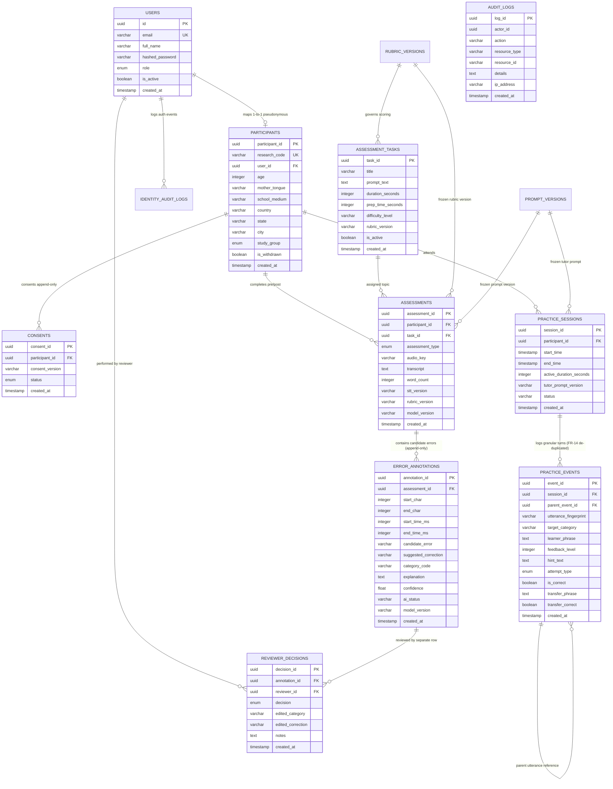

# SyntaxLens Data Model & Schema Specification

## 1. Executive Summary & Design Principles

The SyntaxLens data model provides a dual-schema relational structure engineered in PostgreSQL 16. It guarantees data integrity, privacy protection, and adherence to PhD research methodologies.

### Non-Negotiable Data Architecture Rules
1. **Schema Separation (`identity` vs `research`)**:
   - `identity` schema: Stores PII (participant name, email, credentials, IP logs). Accessible only for authentication and researcher user management.
   - `research` schema: Contains all scientific observations, assessments, audio keys, transcripts, and error classifications. Keyed exclusively by pseudonymous UUIDs (`research_id` / `research_code`). Cross-schema joins are strictly barred from export queries.
2. **Append-Only Research Immutability**:
   - The tables `research.consents`, `research.assessments`, `research.error_annotations`, and `research.audit_logs` are strictly **append-only**.
   - PostgreSQL triggers raise an unrecoverable exception upon any `UPDATE` or `DELETE` statement.
3. **Non-Destructive Human Review Architecture**:
   - Human reviewer actions never overwrite AI model output. Review decisions are recorded in `research.reviewer_decisions` as discrete child rows pointing to `research.error_annotations(annotation_id)`.
4. **Utterance De-Duplication & Recurrence Tracking (SRS FR-14)**:
   - Practice events link to conversational turns. Repeated pedagogical prompts referencing the same student utterance share an `utterance_hash` or `parent_event_id`, ensuring multiple hint steps (L0 $\rightarrow$ L1 $\rightarrow$ L2) do not inflate the student's longitudinal error count.

---

## 2. Entity-Relationship Diagram (ERD)



---

## 3. Schema Definitions & Table Specifications

### 3.1. Schema: `identity` (Personally Identifiable Information & Auth)

#### Table: `identity.users`
Stores user credentials and roles. Completely isolated from research transcripts.
- `id` (UUID, Primary Key, default `gen_random_uuid()`): Stable internal account ID.
- `email` (VARCHAR(255), Unique, Indexed, NOT NULL): Participant or researcher login email.
- `full_name` (VARCHAR(255), NOT NULL): Real name (never forwarded to LLM or included in research exports).
- `hashed_password` (VARCHAR(255), NOT NULL): Cryptographically hashed using Argon2id.
- `role` (ENUM: `'student'`, `'researcher'`, `'reviewer'`, `'admin'`, NOT NULL): System access role.
- `is_active` (BOOLEAN, default `true`, NOT NULL): Deactivation flag.
- `last_login_at` (TIMESTAMP WITH TIME ZONE, Nullable): Security monitoring.
- `created_at` (TIMESTAMP WITH TIME ZONE, default `now()`, NOT NULL).

#### Table: `identity.identity_audit_logs`
Tracks authentication and credential events.
- `id` (UUID, Primary Key): Event identifier.
- `user_id` (UUID, Nullable, Indexed): Foreign key to `identity.users(id)`.
- `event_type` (VARCHAR(50), NOT NULL): `'LOGIN_SUCCESS'`, `'LOGIN_FAILED'`, `'PASSWORD_RESET'`.
- `ip_address` (VARCHAR(45), Nullable): Client IP.
- `user_agent` (VARCHAR(255), Nullable): Client user agent string.
- `status` (VARCHAR(20), NOT NULL): `'SUCCESS'` or `'FAILURE'`.
- `details` (VARCHAR(1000), Nullable): Contextual metadata.
- `created_at` (TIMESTAMP WITH TIME ZONE, default `now()`, NOT NULL).

---

### 3.2. Schema: `research` (Scientific Observations & Assessments)

#### Table: `research.participants`
Pseudonymous cohort participant record. Contains no direct identifiers.
- `participant_id` (UUID, Primary Key, default `gen_random_uuid()`): Primary key for all research joins.
- `research_code` (VARCHAR(50), Unique, Indexed, NOT NULL): Human-readable pseudonymous ID, e.g. `SL-2026-001`.
- `user_id` (UUID, Unique, NOT NULL): Foreign key to `identity.users(id)` with `ON DELETE RESTRICT`.
- `age` (INTEGER, Nullable): Age in years or age band.
- `mother_tongue` (VARCHAR(100), NOT NULL): Participant's primary self-described native language (L1).
- `school_medium` (VARCHAR(100), NOT NULL): Medium of primary/secondary education (e.g. English, Marathi, Hindi).
- `country` (VARCHAR(100), default `'India'`, NOT NULL).
- `state` (VARCHAR(100), Nullable): Geographic state.
- `city` (VARCHAR(100), Nullable): Geographic city.
- `study_group` (ENUM: `'intervention'`, `'control'`, NOT NULL): Experimental group allocation.
- `is_withdrawn` (BOOLEAN, default `false`, NOT NULL): If true, participant's data is excluded from export and analytics.
- `created_at` (TIMESTAMP WITH TIME ZONE, default `now()`, NOT NULL).

#### Table: `research.consents` (APPEND-ONLY)
Immutable consent history. Prohibited from `UPDATE` and `DELETE` via trigger.
- `consent_id` (UUID, Primary Key): Consent transaction ID.
- `participant_id` (UUID, NOT NULL, Indexed): Foreign key to `research.participants(participant_id)`.
- `consent_version` (VARCHAR(50), NOT NULL): Approved protocol consent document version, e.g. `v1.0-ethics-approved`.
- `status` (ENUM: `'consented'`, `'withdrawn'`, NOT NULL): Consent state.
- `created_at` (TIMESTAMP WITH TIME ZONE, default `now()`, NOT NULL): Exact server timestamp of consent action.

#### Table: `research.assessment_tasks`
Standardized task pool (JAM topics) and timing parameters.
- `task_id` (UUID, Primary Key): Task identifier.
- `title` (VARCHAR(200), NOT NULL): Short title of task (e.g. *"A Memorable Journey"*).
- `prompt_text` (TEXT, NOT NULL): Standardized speaking instructions given to the participant.
- `duration_seconds` (INTEGER, default 60, NOT NULL): Maximum recording time allowed.
- `prep_time_seconds` (INTEGER, default 30, NOT NULL): Preparation time before recording triggers.
- `difficulty_level` (VARCHAR(50), default `'standard'`, NOT NULL): Pedagogical difficulty rating.
- `rubric_version` (VARCHAR(50), NOT NULL): Version of the scoring rubric governing this task.
- `is_active` (BOOLEAN, default `true`, NOT NULL): Availability flag for cohort assignment.
- `created_at` (TIMESTAMP WITH TIME ZONE, default `now()`, NOT NULL).

#### Table: `research.assessments` (APPEND-ONLY)
Official pre-test and post-test assessment submissions. Prohibited from `UPDATE` and `DELETE` via trigger.
- `assessment_id` (UUID, Primary Key): Unique assessment identifier.
- `participant_id` (UUID, NOT NULL, Indexed): Foreign key to `research.participants(participant_id)`.
- `task_id` (UUID, NOT NULL): Foreign key to `research.assessment_tasks(task_id)`.
- `assessment_type` (ENUM: `'pre'`, `'post'`, NOT NULL, Indexed): Pre-intervention or post-intervention test.
- `audio_key` (VARCHAR(500), NOT NULL): Secure private S3 object key (never a public URL).
- `transcript` (TEXT, NOT NULL): Faithful verbatim transcript generated by STT (grammar errors preserved).
- `word_count` (INTEGER, NOT NULL): Official word count calculated by the Pure Metrics Engine.
- `stt_version` (VARCHAR(50), NOT NULL): STT provider and model version string (e.g. `mock-stt-v1.0`).
- `rubric_version` (VARCHAR(50), NOT NULL): Frozen rubric version used for scoring.
- `model_version` (VARCHAR(50), NOT NULL): Syntax analysis model version string.
- `created_at` (TIMESTAMP WITH TIME ZONE, default `now()`, NOT NULL).

#### Table: `research.error_annotations` (APPEND-ONLY)
Candidate syntactic deviations identified by AI. Prohibited from `UPDATE` and `DELETE` via trigger.
- `annotation_id` (UUID, Primary Key): Unique candidate error identifier.
- `assessment_id` (UUID, NOT NULL, Indexed): Foreign key to `research.assessments(assessment_id)`.
- `start_char` (INTEGER, NOT NULL): Zero-indexed start character offset in `transcript`.
- `end_char` (INTEGER, NOT NULL): Zero-indexed end character offset in `transcript`.
- `start_time_ms` (INTEGER, Nullable): Audio millisecond offset start for Evidence Lens audio seeking.
- `end_time_ms` (INTEGER, Nullable): Audio millisecond offset end.
- `candidate_error` (VARCHAR(255), NOT NULL): Exact verbatim word or phrase extracted.
- `suggested_correction` (VARCHAR(255), NOT NULL): Grammatically accurate target form.
- `category_code` (VARCHAR(10), NOT NULL, Indexed): Taxonomy category (`TNS`, `SVA`, `WO`, `AUX`, `ART`, `PREP`, `PRO`, `OTH`).
- `explanation` (TEXT, NOT NULL): Scientific explanation of the syntactic rule.
- `confidence` (FLOAT, NOT NULL): AI model confidence score (0.0 to 1.0).
- `ai_status` (VARCHAR(50), default `'candidate'`, NOT NULL): Initial status before human verification.
- `model_version` (VARCHAR(50), NOT NULL): Version of LLM producing the finding.
- `created_at` (TIMESTAMP WITH TIME ZONE, default `now()`, NOT NULL).

#### Table: `research.reviewer_decisions`
Independent human review decisions. Stored as distinct rows to ensure AI output is never overwritten.
- `decision_id` (UUID, Primary Key): Unique decision identifier.
- `annotation_id` (UUID, NOT NULL, Indexed): Foreign key to `research.error_annotations(annotation_id)`.
- `reviewer_id` (UUID, NOT NULL): Foreign key to `identity.users(id)` identifying the reviewing linguist.
- `decision` (ENUM: `'accepted'`, `'rejected'`, `'edited'`, `'uncertain'`, NOT NULL): Review outcome.
- `edited_category` (VARCHAR(10), Nullable): Overriding category code if the reviewer amended the taxonomy label.
- `edited_correction` (VARCHAR(255), Nullable): Overriding correction if reviewer amended target form.
- `notes` (TEXT, Nullable): Reviewer justification notes.
- `created_at` (TIMESTAMP WITH TIME ZONE, default `now()`, NOT NULL).

#### Table: `research.practice_sessions`
Conversational practice session logging.
- `session_id` (UUID, Primary Key): Practice session identifier.
- `participant_id` (UUID, NOT NULL, Indexed): Foreign key to `research.participants(participant_id)`.
- `start_time` (TIMESTAMP WITH TIME ZONE, default `now()`, NOT NULL).
- `end_time` (TIMESTAMP WITH TIME ZONE, Nullable): Set upon session completion.
- `active_duration_seconds` (INTEGER, default 0, NOT NULL): Cumulative active engaged practice seconds.
- `tutor_prompt_version` (VARCHAR(50), NOT NULL): Frozen prompt version governing tutor behavior.
- `status` (VARCHAR(50), default `'active'`, NOT NULL): Session state (`'active'`, `'completed'`, `'abandoned'`).
- `created_at` (TIMESTAMP WITH TIME ZONE, default `now()`, NOT NULL).

#### Table: `research.practice_events` (FR-14 Double-Counting Protection)
Granular tutor steps and self-correction attempts.
- `event_id` (UUID, Primary Key): Unique event identifier.
- `session_id` (UUID, NOT NULL, Indexed): Foreign key to `research.practice_sessions(session_id)`.
- `parent_event_id` (UUID, Nullable, Indexed): Self-referencing FK to `practice_events(event_id)` linking multiple hint stages (L0, L1, L2, L3) triggered by the same single learner utterance.
- `utterance_fingerprint` (VARCHAR(64), Nullable, Indexed): SHA-256 hash of normalized learner phrase. Used by the recurrence engine to prevent counting multiple hint steps as separate independent errors.
- `target_category` (VARCHAR(10), NOT NULL, Indexed): Syntactic structure addressed.
- `learner_phrase` (TEXT, NOT NULL): Verbatim utterance transcribed during practice.
- `feedback_level` (INTEGER, NOT NULL): 0 (quote), 1 (hint question), 2 (rule cue), 3 (reveal).
- `hint_text` (TEXT, Nullable): Exact prompt text presented to learner.
- `attempt_type` (ENUM: `'independent'`, `'hint_assisted'`, `'revealed'`, NOT NULL): Level of assistance required.
- `is_correct` (BOOLEAN, NOT NULL): Self-correction outcome.
- `transfer_phrase` (TEXT, Nullable): New sentence produced during transfer check.
- `transfer_correct` (BOOLEAN, Nullable): Transfer check evaluation outcome.
- `created_at` (TIMESTAMP WITH TIME ZONE, default `now()`, NOT NULL).

#### Table: `research.audit_logs` (APPEND-ONLY)
Comprehensive research action audit trail. Prohibited from `UPDATE` and `DELETE` via trigger.
- `log_id` (UUID, Primary Key): Log identifier.
- `actor_id` (UUID, Nullable, Indexed): Foreign key or UUID of acting user.
- `action` (VARCHAR(100), NOT NULL): Action identifier (e.g. `'ASSESSMENT_SUBMITTED'`, `'REVIEW_DECIDED'`, `'RESEARCH_DATA_EXPORTED'`).
- `resource_type` (VARCHAR(50), NOT NULL): Target entity type (`'assessment'`, `'annotation'`, `'participant'`).
- `resource_id` (VARCHAR(100), NOT NULL): ID of the affected entity.
- `details` (TEXT, Nullable): JSON-encoded metadata regarding parameters and changes.
- `ip_address` (VARCHAR(45), Nullable): Originating IP address.
- `created_at` (TIMESTAMP WITH TIME ZONE, default `now()`, NOT NULL).

#### Tables: `research.rubric_versions` & `research.prompt_versions`
Configuration freezing tables enforcing SRS FR-20.
- `rubric_versions`: `rubric_id` (UUID PK), `version_code` (VARCHAR Unique), `name`, `description`, `taxonomy_json` (TEXT), `is_frozen` (BOOLEAN default true).
- `prompt_versions`: `prompt_id` (UUID PK), `prompt_type` (VARCHAR), `version_code` (VARCHAR Unique), `prompt_template` (TEXT), `is_frozen` (BOOLEAN default true).

---

## 4. Database Trigger Specifications (Immutability Enforcement)

The database triggers are implemented as stored PL/pgSQL procedures in PostgreSQL:

```sql
CREATE OR REPLACE FUNCTION prevent_row_mutation_or_deletion()
RETURNS TRIGGER AS $$
BEGIN
    RAISE EXCEPTION 'RESEARCH INTEGRITY VIOLATION: Records in table %.% are strictly append-only and cannot be updated or deleted.', 
        TG_TABLE_SCHEMA, TG_TABLE_NAME;
END;
$$ LANGUAGE plpgsql;

-- Applied to Append-Only tables:
CREATE TRIGGER trg_consents_immutability
BEFORE UPDATE OR DELETE ON research.consents
FOR EACH ROW EXECUTE FUNCTION prevent_row_mutation_or_deletion();

CREATE TRIGGER trg_assessments_immutability
BEFORE UPDATE OR DELETE ON research.assessments
FOR EACH ROW EXECUTE FUNCTION prevent_row_mutation_or_deletion();

CREATE TRIGGER trg_error_annotations_immutability
BEFORE UPDATE OR DELETE ON research.error_annotations
FOR EACH ROW EXECUTE FUNCTION prevent_row_mutation_or_deletion();

CREATE TRIGGER trg_audit_logs_immutability
BEFORE UPDATE OR DELETE ON research.audit_logs
FOR EACH ROW EXECUTE FUNCTION prevent_row_mutation_or_deletion();
```

---

## 5. FR-14 De-Duplication Logic

To satisfy SRS FR-14 (*"Track error categories and patterns across sessions without counting repeated references to the same single utterance as separate independent errors"*):
1. When a learner makes an error during practice, an initial `practice_events` row is created with `feedback_level = 0` and a generated `utterance_fingerprint`.
2. Subsequent Hint Ladder steps (L1 hint, L2 rule cue, L3 reveal) populate `parent_event_id` referencing the initial event's `event_id` and retain the identical `utterance_fingerprint`.
3. The Recurrence and Metrics module queries:
   ```sql
   SELECT target_category, COUNT(DISTINCT utterance_fingerprint) as distinct_error_events
   FROM research.practice_events
   WHERE session_id = :session_id AND is_correct = false;
   ```
   This guarantees that an utterance prompting three successive hints is counted as **exactly one** syntactic breakdown event, preventing artificial inflation of error statistics.
